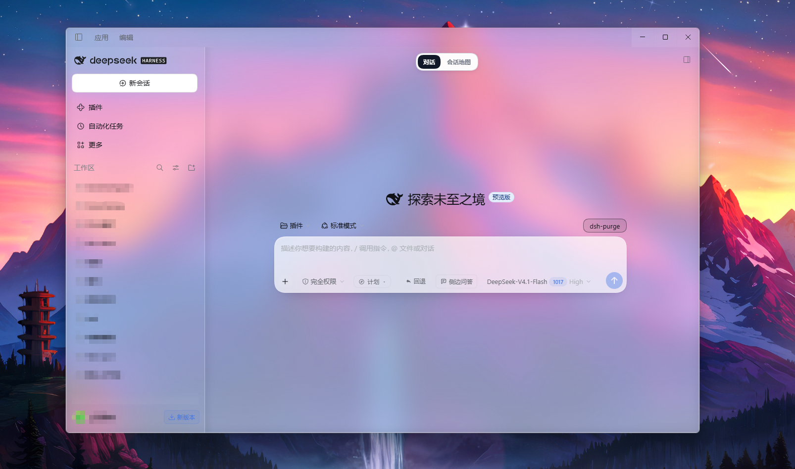

# DSH Frosted Glass · 磨砂玻璃

为 DSH 的 Web 对话界面提供半透明面板、背景模糊和玻璃边缘高光，跟随浅色与深色主题。当前版本：**0.2.0**。

这是第三方外观插件，依赖 DSH 的客户端模块加载器、主题令牌和设置插槽，不能作为独立网页直接运行。



实际界面效果示例，侧栏信息已遮挡。效果会随系统材质、壁纸和 DSH 版本变化。

## 功能

- 为侧栏、聊天区、输入卡、气泡及弹出层设置半透明表面。
- 设置页提供模糊半径、面板不透明度、窗口棱边强度三个滑杆。
- 设置面板、输入卡和工具提示保留较高不透明度，优先保证可读性。
- 窗口缩放期间临时关闭页面模糊，结束后恢复。
- 不做边缘折射：原因见「与 iOS 液态玻璃的差距」，不是参数没调够。
- 支持 Windows 窗口材质、内置抽象背景和纯 CSS 光场三种底板方案。

## 安装

需要 Git、Node.js，以及 DSH profile 使用的 pnpm。尚未发布到 npm。

```powershell
git clone https://github.com/ZDS36/dsh-frosted-glass.git
cd dsh-frosted-glass
npm test
```

在 DSH 当前 profile 目录的 `package.json` 中，将以下两项合并进原有配置。常见 profile 路径为 `~/.dsh/profiles/<profile>/`；先确认当前使用的 profile，并备份其配置。

```json
{
  "dependencies": {
    "dsh-frosted-glass": "link:D:/plugins/dsh-frosted-glass"
  },
  "dsh": {
    "profile": {
      "bundles": [
        "dsh-frosted-glass"
      ]
    }
  }
}
```

将 `D:/plugins/dsh-frosted-glass` 换成实际克隆目录，保留原有依赖与 bundles 条目。在 **profile 目录**运行 `pnpm install`，然后退出并重新打开 DSH。插件列表中应出现「磨砂玻璃」。重启前先结束正在运行的任务。

## 从旧名称升级

项目原名为 `dsh-liquid-glass`（液态玻璃），现更名为 `dsh-frosted-glass`（磨砂玻璃）。已有安装需将 profile 中 `dependencies` 的包名和 `dsh.profile.bundles` 的条目一起改为新名，然后在 profile 目录运行 `pnpm install` 并重启 DSH；不要同时启用新旧两个条目。`link:` 后的本地目录可保持不变，三个 `dsg.*` 外观设置沿用原值。

已有 Git 克隆可更新远端：

```powershell
git remote set-url origin https://github.com/ZDS36/dsh-frosted-glass.git
```

## 选择背景方案

编辑 `client.js` 顶部 `CONFIG.backdrop`，保存后重新加载插件或重启 DSH。

| 值 | 背景 | 条件 |
| --- | --- | --- |
| `'none'`（当前默认） | 页面透明，供桌面窗口材质显示 | 需要支持材质的桌面壳；Windows 主窗口补丁见下文 |
| `'wallpaper'` | 随插件内嵌的抽象渐变 SVG | 无需修改桌面壳 |
| `'field'` | 页面内的静态彩色光场 | 无需修改桌面壳 |

**首次使用且不想修改 DSH 安装文件，建议选择 `'field'`。** 默认的 `'none'` 不会自动给桌面壳打补丁；没有窗口材质时，也不会自动透出桌面。

`wallpaper` 只是历史配置名。发布版使用原创的 [backdrop.svg](backdrop.svg)，不会自动读取你的系统壁纸。修改该 SVG 后，运行：

```powershell
node test/embed-backdrop.cjs
npm test
```

脚本会先备份 `client.js`，再更新其内嵌背景。自定义背景会随 `client.js` 一起发布，提交前请自行确认其中没有隐私内容和外部资源引用。

## 可选：Windows 主窗口材质补丁

此功能面向支持窗口材质的 Windows 11 / Electron 环境。实际效果取决于 DSH、Electron 和系统设置；不保证兼容所有版本。

插件本身只改页面样式。要让 `'none'` 模式显示窗口后方的系统材质，需要额外运行 [tools/patch-main-window.mjs](tools/patch-main-window.mjs)，它会修改 **DSH 安装目录**中的 `resources/app/lib/main.js`。仅在需要该效果时手动执行。

在 PowerShell 中指定实际安装文件路径：

```powershell
$env:DSH_MAIN_JS = 'D:/Apps/DSH/resources/app/lib/main.js'
node tools/patch-main-window.mjs --status
node tools/patch-main-window.mjs --check
```

`--status` 和 `--check` 只读取、显示状态及预期改动。检查无误后：

```powershell
node tools/patch-main-window.mjs --apply
```

脚本要求目标代码片段精确匹配且仅出现一次，否则拒绝写入；写入前创建 `main.js.bak-<时间戳>` 备份。退出并重新打开 DSH 后生效，**重启会中断正在运行的任务**。DSH 更新可能覆盖补丁；遇到不匹配不要强行替换。

恢复最新备份：

```powershell
node tools/patch-main-window.mjs --revert
```

恢复时也会保留修改后文件的副本。如果 DSH 已更新，请先确认备份属于当前版本，避免把旧版主程序文件覆盖回来。仓库不包含 DSH 的程序文件或本机备份。

## 与 iOS 液态玻璃的差距

iOS 26 的 Liquid Glass 有三个特征：**边缘真实折射**（背后内容在玻璃边缘被弯折、放大）、
**动态镜面高光**（随设备姿态移动）、**自适应材质**（按背后内容调整明暗与饱和度）。
本插件没有实现这些动态效果：当前只调整页面样式和固定高光，不读取设备姿态、桌面画面或背后内容。

### 拿不到桌面像素

窗口后面的画面由 Windows DWM 在系统合成阶段画上去；渲染进程的 `backdrop-filter`
只能加工页面可用的背景内容，不能直接处理 DWM 在窗口后方合成的桌面。以下为开发阶段特定 Chromium 配置的实验记录，本次发布检查未复测这些像素差异：

| 实验 | 结果 |
| --- | --- |
| `backdrop-filter: blur(6px)` | 生效，差异 2.86 级 |
| `backdrop-filter: url(#svg位移滤镜)` | **生效**，差异 4.04 级，色块边缘真的被弯折 |
| `backdrop-filter: url(#不存在的id)` | 像素级退化为"无滤镜"，不会黑块 |

这些记录表明 SVG 位移滤镜在当时的测试环境生效；不代表所有 Chromium 版本的兼容性或安全保证。它作用的对象仍限于页面自身的内容。
窗口外沿背后是系统材质，那里没有可弯折的东西。

### 先模糊再位移，等于没位移

把位移串在模糊之后（`blur(28px) … url(#透镜)`），开 / 关两次渲染做差：

| 位置 | 差异 |
| --- | --- |
| 输入卡边缘 12px 环，**不加模糊** | 1.03 级，位移拉满时肉眼可见 |
| 整张卡片，串在 `blur(28px)` 之后 | **0.05 级**，等于没有 |

在上述测试画面中，28px 模糊使位移差异很小，因此未保留这两个实验实现。这是当前参数和画面的结果，不表示模糊与折射在所有实现中都无法共存。

### 本插件不采用截屏自绘

直接将含有本窗口的截图画回窗口会产生递归。Windows 的 `WDA_EXCLUDEFROMCAPTURE` 可在受支持的捕获接口中排除窗口，Electron 的 `setContentProtection` 在 Windows 上使用这一能力；并非必须隐藏窗口。详见 [Electron 文档](https://www.electronjs.org/docs/latest/api/browser-window#winsetcontentprotectionenable-macos-windows) 与 [Microsoft 文档](https://learn.microsoft.com/en-us/windows/win32/api/winuser/nf-winuser-setwindowdisplayaffinity)。

即使排除自身，捕获和自绘仍增加开销与隐私暴露面。仅按未压缩像素估算：一帧 1282×821×4 B ≈ 4.2 MB，30 fps 就是 126 MB/s 的内存搬运再加上一次高斯，
这里未包含实际捕获、GPU 传输和滤镜开销。若将屏幕像素传入渲染进程，其他窗口的私密内容也可能进入其内存；本插件不实现该功能。

### 亮背景下，白色高光压不出白

镜面反光之所以像玻璃，是因为它能比环境更亮。CSS 的上限是 255：0.15 的白盖在 230 的底上只多 4 级。
因此在当前普通 CSS 叠色方案中，浅色背景上的高光对比度有限。

### 系统材质本身就是磨砂的

`backgroundMaterial: "acrylic"` 的模糊半径、色调和内建噪声全部由 Windows 决定，
Electron 只暴露名字（`acrylic / mica / tabbed / none`）。亚克力本身就是磨砂材质，
页面能控制的只有"往上压了多少白"。这也是关掉系统透明效果时必须退回实心界面的原因。

### 实际做到了哪一步

| 目标 | 做法 |
| --- | --- |
| 颜色保真，不像白纸 | 中栏合成不透明度压到 6.7 %，薄纱归零 |
| 有厚度 | 边缘只折光不描边：轮廓高光 + 3px 折光 + 22px 厚度暗影 |
| 有材质 | 1.2 % 微颗粒（`feTurbulence` 平铺，静态贴图） |
| 有反光 | 左上主光斑 + 右下回光两块径向渐变 |
| 不像相框 | 接缝用同一套折光语言，不给实线 |

若要实现更复杂的折射和动态光照，需要重新设计渲染方案；桌面捕获只是其中一种方向，还需单独验证兼容性、性能和隐私。当前插件不包含这类实现。

## 设置

启用插件后，在「设置 → 通用」中调整：

| 设置 | 范围 | 默认值 |
| --- | --- | --- |
| 玻璃模糊半径 | 0–60 px，0 关闭页面模糊 | 28 px |
| 面板不透明度 | 40–160%，越高越实 | 100% |
| 窗口棱边强度 | 0–150% | 100% |

设置即时生效，分别保存在本地 `localStorage` 的 `dsg.blur`、`dsg.tint`、`dsg.rim` 中。当前棱边计算在 100% 封顶，100–150% 的视觉效果相同。面板不透明度不会降低设置面板、输入卡和工具提示的固定不透明度。

模糊与透明度会影响 GPU 开销及文字对比度。若出现菜单定位异常、缩放卡顿或文字不清晰，可降低模糊半径、提高面板不透明度，或停用插件。

## 开发与检查

```powershell
npm test                          # probe-css + probe-anchors
npm run audit -- --root 'D:/Apps/DSH/resources/app/dsh/node_modules' # 换成实际路径
node --check client.js
node --check tools/patch-main-window.mjs
node test/preview.mjs
```

`npm test` 使用 Node.js 内置模块，无需安装额外依赖，检查生成的 CSS、表面令牌、透明度计算、设置插槽和缩放守卫。`preview.mjs` 生成 `test/preview-glass.html`，内容是虚构消息，可在浏览器中打开查看静态布局；它不能验证系统窗口材质。

`test/` 中的 PowerShell 脚本是手动截图或性能诊断工具，不属于插件运行逻辑。部分脚本包含本机测量时的进程 ID，使用前需按实际进程调整；它们不会在 `npm test` 中运行。截图可能包含屏幕内容，请勿直接提交。

项目结构：

```text
client.js                    客户端样式与设置
index.js                     无运行逻辑的 Host 入口
cordis.patch.yml              DSH bundle 注册
locale/                      插件元信息翻译
backdrop.svg                 可公开分发的抽象背景
icon.svg                     插件图标
tools/patch-main-window.mjs   可选的桌面主窗口补丁工具
test/                        CSS 检查、预览与手动诊断
```

当前检查覆盖 Node 环境下的静态与模拟 DOM 行为，不代表所有 DSH 版本、系统材质或长时间使用均已验证。插件使用 DSH 内部 CSS 类名后缀和插槽，DSH 更新后可能需要适配。

### 跨版本适配

样式全部挂在宿主自己产出的东西上：CSS 模块类名后缀、`--dsw-*` 主题令牌、`data-*` 属性。
它们变了以后样式表**不会报错**，只是不再匹配——所以有三层保障：

1. **增加备用锚点。** 输入座优先识别宿主的 `data-composer-seat`，其次使用 textarea 祖先的 composer 类名或原类名后缀；中栏和侧栏仍依赖类名中的 `centerCol / sidebarCol`。识别后标记 `data-dsg-*`，关键外框、中栏与输入卡规则接受这些标记；其余规则仍可能依赖原类名。七个模拟 DOM 场景覆盖正常与退化布局、延迟挂载、重试上限和热重载清理：`node test/probe-anchors.mjs`。
2. **钩子体检。** `npm run audit -- --root <DSH 的 node_modules 目录>` 在宿主 bundles 中检查 10 个类名后缀、31 条主题令牌和两个必需钩子；缺少必需项时非零退出。`data-composer-stat` 是可选统计插件的钩子，缺失只提示。检查不读取本机其他插件目录，也不包含固定安装路径；源码中存在钩子不代表实际 DOM 一定匹配。
3. **材质缺席时退回实心界面。** 系统关掉透明效果（`prefers-reduced-transparency: reduce`）时，
   整张表面表钉到 98 %——界面变回普通的、看得清的样子，而不是一块没有材质的空玻璃。

本次已核对本机 DSH 安装目录的 97 个客户端 bundle，必需钩子检查通过；未验证其他版本或实际界面。浏览器是否随系统透明度开关报告上述媒体特性，仍需实际环境验证。

插件**不会**因为认不出锚点就自行切成不透明：猜错一次就是整界面变实心，比少一层玻璃更糟。
启动期间最多尝试识别 12 次，约 1.8 秒后停止；此后新挂载或替换的节点不会继续重试。未完整识别时会在控制台留一行 `[frosted-glass] anchors unresolved`，配合 `audit` 定位。

| 变化 | 后果 |
| --- | --- |
| `main.js` 被 DSH 更新覆盖 | 窗口退回不透明，界面本身正常；`--status` 可查，`--apply` 补回 |
| 类名与结构同时大改 | 锚点认不出，控制台留 warn，效果只作用于认得的元素 |
| 主题令牌改名 | 对应表面退回主题默认（通常不透明），其余照旧 |
| 非 Windows | Windows 窗口材质补丁不适用；可尝试 `field / wallpaper` 页面背景，效果未验证 |
| 未安装 `usage-cost` | 下方数据胶囊没有玻璃底，其余不受影响 |

## 隐私

- 当前插件代码没有网络请求、遥测、账号凭据或会话内容读取逻辑；Host 入口为空。
- 插件只保存上述三个本地外观数值，不自动截屏或读取系统壁纸。
- 手动截图脚本与窗口补丁工具只有在用户执行时才运行。
- 本机壁纸文件、原始会话截图、备份、生成的预览 HTML、日志和常见凭据文件由 `.gitignore` 排除；发布背景也已替换为原创 SVG，不保留原壁纸的内嵌数据。README 的展示图为用户提供并已遮挡侧栏信息的图片。
- MIT 许可与上游署名见 [LICENSE](LICENSE)、[NOTICE](NOTICE)。

## 停用与卸载

在「设置 → 插件」中停用。彻底卸载时，从 profile 的 `dependencies` 和 `dsh.profile.bundles` 中移除对应条目，在 profile 目录运行 `pnpm install` 后重启 DSH。

插件通过 `ctx.effect` 回收样式、插槽和监听器；三个外观数值仍保存在本地。若使用过窗口材质补丁，需要另外按上面的命令恢复，它不受插件开关控制。

## 致谢与许可

参考 [david0304git/dsh-appearance-glass](https://github.com/david0304git/dsh-appearance-glass) 的分层透明度补偿思路、表面令牌命名及部分选择器。上游声明保留在 [NOTICE](NOTICE)。

代码、图标和本仓库原创抽象背景使用 [MIT License](LICENSE)。
